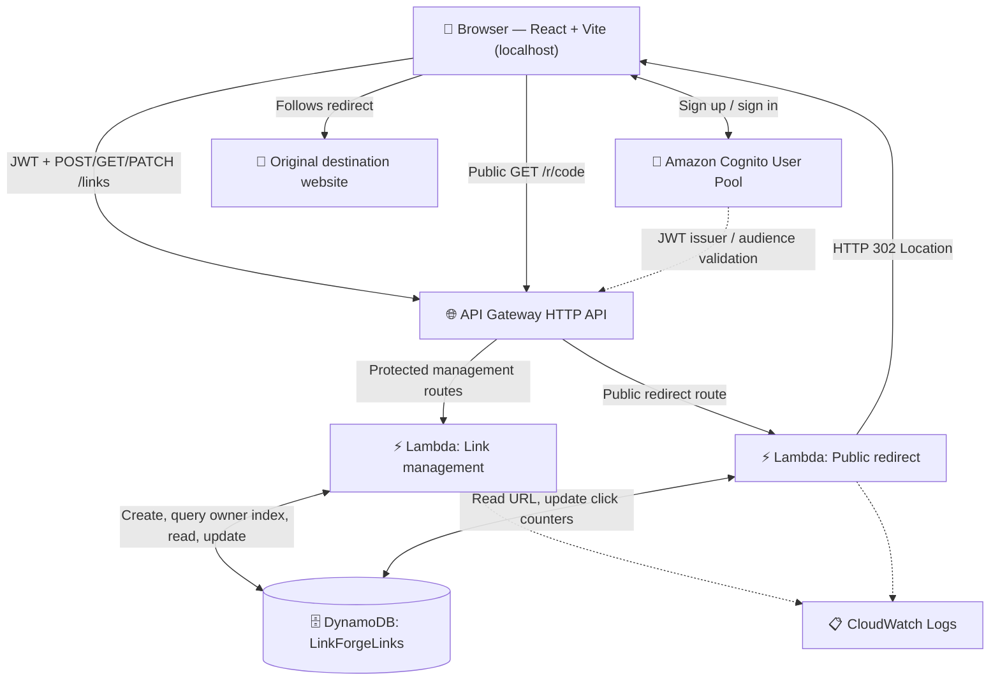

# 🏗️ LinkForge Architecture

This diagram describes the infrastructure defined in `infrastructure/template.yaml`.

## AWS resources

| Resource | Job | Access |
|---|---|---|
| Cognito User Pool + web client | Sign-up, sign-in, JWT issuance | Users authenticate |
| HTTP API | Routes traffic; JWT authorizer for management | Protected management, public redirects |
| Link-management Lambda | Create, list, fetch stats, toggle active status | JWT / owner checks |
| Redirect Lambda | Lookup, count, redirect | Public |
| DynamoDB `LinkForgeLinks` | Store URL items and daily counter items | IAM-restricted Lambda access |
| DynamoDB `OwnerIndex` GSI | Query links by owner and creation time | Management Lambda |
| CloudWatch | Lambda execution logs | AWS operators |
| CloudFormation/SAM | Infrastructure deployment and updates | Developer / operator |

## Data model

**Link item:** partition key `shortCode` (for example `Ab72xK9`), attributes `originalUrl`, `ownerId`, `createdAt`, `isActive`, `totalClicks`, optional `expiresAt`, and optional `lastClickedAt`.

**Daily aggregate item:** partition key `shortCode = DAY#<code>#<YYYY-MM-DD>`, attribute `clicks`. No raw visitor event trail is retained.

**OwnerIndex GSI:** partition key `ownerId`, sort key `createdAt`, used for the authenticated link listing. Daily aggregate items do not appear in this index.

## Important implementation details

- HTTP `302` and `Cache-Control: no-store` allow the redirect Lambda to count requests rather than serving a cached redirect.
- The click counter is updated atomically in DynamoDB; the daily aggregate is a second write, so transient failures may cause mismatches.
- The data model and API are intentionally simple for a portfolio MVP. They are not a high-scale analytics architecture.
- The frontend is served by a local development server; **CloudFront and frontend S3 hosting are not part of this deployment**.
- No public GitHub link is included until the final publication step.
